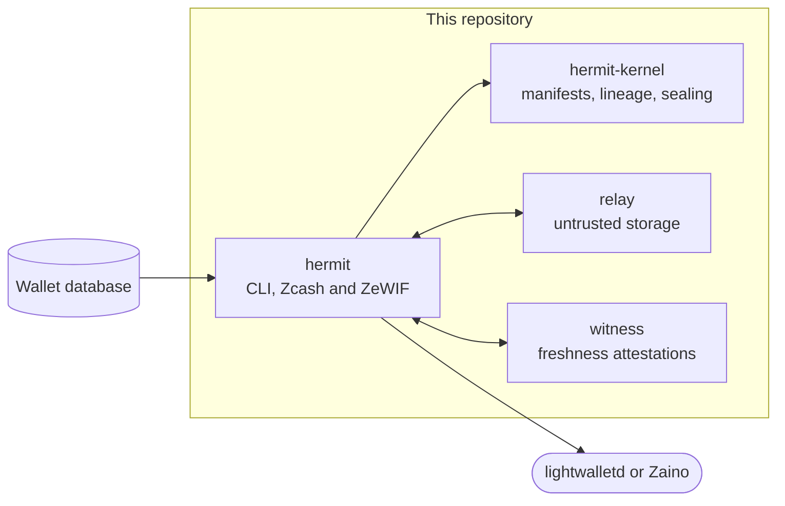

# Hermit

Wallets are shells. Your state moves on.

A seed phrase is not a wallet. Restore one into a different Zcash app and it rescans
history from the birthday, may derive addresses differently, and loses every label you
wrote. Hermit moves the already-scanned state of a shielded wallet instead: sealed in
an encrypted, signed capsule, verified on arrival, and resumed where the old device
left off. The spend key stays behind unless you ask for it.

## What it does

1. **Seal.** Takes a wallet's scanned database and its labels and seals each part
   with age to every device you have authorized. Each change is a manifest signed by
   the device that made it.
2. **Store anywhere.** Capsules go to a relay, a folder or another device. Storage
   holds encrypted, padded blobs and cannot forge, reorder or quietly roll back history.
3. **Pair.** The old device prints a QR code; both screens show the same nine-digit
   code before the new device joins.
4. **Verify.** The new device checks the full lineage from the pinned genesis, every
   signature, and the chain anchor against a lightwalletd server, then restores. It
   syncs only the blocks after the anchor.
5. **Switch apps.** Exports the verified head as a view-only ZeWIF document (the Zcash
   Wallet Interchange Format), which carries the ZIP 32 derivation and every address the
   wallet handed out. `zcash_client_sqlite`'s own importer turns it into a new wallet.

## What works today

| Area                             | Status                                                                     |
| -------------------------------- | -------------------------------------------------------------------------- |
| Device to device                 | Testnet and regtest, with `zcash-devtool` wallets                          |
| Spending after a move            | Regtest: the new device sent a shielded payment with a memo               |
| App to app through ZeWIF         | Same address, same balance, the same 114 of 114 transactions              |
| ZeWIF conformance                | Exports validate against the normative CDDL schema                         |
| Labels across devices            | Concurrent edits on two devices merge per key                              |
| Adding and revoking devices      | Every section is re-sealed; a revoked device cannot read new state         |
| Freshness witness                | Optional; catches a relay hiding updates even from a device that was offline |
| Tor or Nym routing               | Relay and witness traffic through SOCKS5, fails closed                     |

Measured on testnet with a wallet 112,788 blocks deep: a full sync took 245 seconds.
Restoring through Hermit and syncing took 12 seconds, with 48 blocks left to scan.

## How the pieces fit



| Folder                 | What it is                                                                                                                         |
| ---------------------- | ---------------------------------------------------------------------------------------------------------------------------------- |
| `crates/hermit-kernel` | The capsule model. Signed manifests in a DAG, sealing, padding, and the verdict on any set of heads. Knows nothing about Zcash.     |
| `apps/hermit`          | The command line. Reads and restores `zcash_client_sqlite` wallets, checks anchors on chain, pairs devices, exports and adopts ZeWIF. |
| `apps/relay`           | A small HTTP store for blobs and manifests. It is trusted with nothing.                                                            |
| `apps/witness`         | Signs the newest head it has verified for each capsule, so a relay cannot serve an older one unnoticed.                           |

### What a capsule decides

Every section has a class, and the class decides what happens when two devices change
the wallet at the same time.

| Class      | Holds                       | On concurrent changes                                   |
| ---------- | --------------------------- | ------------------------------------------------------- |
| `Progress` | The scanned wallet database | The version with the higher chain-verified anchor wins  |
| `Metadata` | Labels, contacts, tx notes  | Merged per key                                          |
| `Secret`   | The encrypted mnemonic      | Never merged; concurrent edits are a conflict           |
| `Derived`  | Anything re-derivable       | Checked against the chain, never trusted blindly        |

Reading a set of heads gives one verdict: `Ok`, `Rollback`, `ForkMergeable`, `Conflict`,
`Diverged` or `Empty`. Concurrent changes to who may write are never merged
automatically; `hermit resolve` lets a person choose which device set survives.

## Run it

Requirements: stable Rust and a wallet made with
[zcash-devtool](https://github.com/zcash/zcash-devtool) and synced on testnet.

```sh
git clone https://github.com/dakewamama/hermit.git
cd hermit
cargo build --release
export PATH=$PWD/target/release:$PATH
```

Start a relay (and, if you want freshness checks, a witness):

```sh
hermit-relay --listen 127.0.0.1:8787 --data relay-data &
hermit-witness --listen 127.0.0.1:8788 --data witness-data &
```

Move a wallet from a laptop to a phone. Each device has its own home directory.

```sh
hermit --home laptop device init --name laptop
hermit --home phone device init --name phone > phone.json

hermit --home laptop create --wallet ~/my-wallet --store http://127.0.0.1:8787 \
  --witness http://127.0.0.1:8788
hermit --home laptop device add phone.json
hermit --home laptop pair --qr            # or: pair > pair.json

hermit --home phone join pair.json
hermit --home phone restore --into phone-wallet
```

`restore` checks the anchor against a public lightwalletd server for testnet and
mainnet; pass `--server` for your own, or `--offline` to check lineage only.
The restored directory opens with `zcash-devtool wallet -w phone-wallet`.

Other commands:

```sh
hermit --home laptop snapshot --wallet ~/my-wallet   # record the wallet's new state
hermit --home laptop label tx:first "rent October"   # labels travel with the capsule
hermit --home phone sync http://127.0.0.1:8787       # exchange with another store
hermit --home phone status                           # lineage and anchor verdict
hermit --home phone merge                            # reconcile a mergeable fork
hermit --home phone log                              # the verified history
hermit --home laptop zewif --out wallet.zewif        # view-only export
hermit --home laptop adopt wallet.zewif --into other-wallet
```

Pass `--proxy socks5://127.0.0.1:9050` to send relay and witness traffic through Tor.

## Tests

| Command                                                      | What runs                                                     |
| ------------------------------------------------------------ | ------------------------------------------------------------- |
| `cargo test --workspace`                                     | 50 tests: 27 kernel, 14 CLI, 7 witness, 2 relay               |
| `cargo test -p hermit --test switching -- --ignored`         | Both switches against a real regtest chain (see below)        |
| `cargo run -p hermit --example zewif_conformance -- <file>`  | Validates a ZeWIF export against the CDDL schema               |

The kernel scenarios cover rollback, withheld and corrupted state, forks that merge,
concurrent secret edits, a revoked device writing on a concurrent branch, and conflicts
over who may write.

The switching test needs Zebra in regtest mode behind Zaino, and a synced
`zcash-devtool` wallet on it:

```sh
HERMIT_TEST_WALLET=/path/to/wallet \
HERMIT_TEST_SERVER=127.0.0.1:8137 \
HERMIT_TEST_DEVTOOL=/path/to/zcash-devtool \
cargo test -p hermit --test switching -- --ignored
```

It moves the wallet device to device and app to app, and requires each result to hold
exactly the original's transactions.

## What storage can see

The relay and witness are never trusted with wallet data, but they are not blind.

| Visible to storage                                              | Sealed                                   |
| --------------------------------------------------------------- | ---------------------------------------- |
| Device names, public keys and age recipients                    | Every section's contents                 |
| The anchor: network, height and block hash                      | Labels, contacts and transaction notes   |
| Section names and classes, padded sizes                         | The note describing each change          |
| Sequence numbers, parents, timing                               | The mnemonic, when it is carried at all  |

Sizes are padded with Padmé, so storage learns a size class, not an exact length.

## Limits

- **Fast switching needs `zcash_client_sqlite`.** That covers zcash-devtool, Zallet and
  the mobile SDKs. Any of them can adopt state through ZeWIF, but upstream's importer
  rescans from the birthday and does not keep labels yet.
- **Zallet** has the ZeWIF importer but no command to import a `.zewif` file yet.
- **Chain checks are not proxied.** With `--proxy`, pass `--offline` or a server you run.
- **Revocation is forward-only.** A revoked device keeps what it already decrypted.
- **Spend authority** never travels by default. With `--include-secret` the mnemonic
  travels still encrypted to the wallet's own age identity, which you move separately.

## License

MIT
